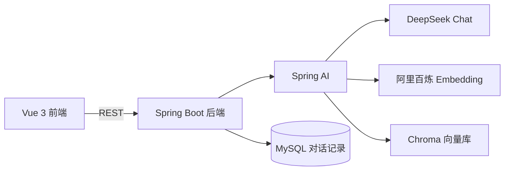

# Simple AI · 可插拔 RAG 知识库问答

基于 **Spring AI + Chroma** 的检索增强生成（RAG）问答系统，前后端分离，支持文档上传、向量检索、引用溯源与防幻觉兜底。

面向「可低侵入移植到现有 Spring Boot 后端」的场景设计：核心能力是一组标准 REST 接口，前端只是配套的演示实现。

---

## 架构



**离线索引**：文档 → 分块（Token 级，带重叠）→ 向量化 → 写入 Chroma
**在线问答**：问题 → 向量化 → 相似度检索 Top-K → 拼入 Prompt → 大模型生成 → 返回答案 + 引用来源

## 技术栈

| 层 | 技术 |
|---|---|
| 后端 | Spring Boot 3.5.9 · Spring AI 1.1.0 · MyBatis-Plus 3.5.9 |
| 模型 | DeepSeek（对话）· 阿里百炼 `text-embedding-v3`（1024 维向量） |
| 向量库 | Chroma 1.0（Docker） |
| 存储 | MySQL |
| 前端 | Vue 3.5 · Vite 8 · Element Plus 2.14 · vue-element-plus-x 2.0 |

## 功能

- **双问答模式**：普通大模型对话 / 知识库检索增强问答
- **文档入库**：MD / TXT 上传，自动分块、向量化、批量写入（适配百炼单次 10 条上限）
- **引用溯源**：回答附带命中片段的文件名、相似度百分比、内容摘要
- **检索过程可视化**：把「检索 → 生成」的内部链路展示给用户
- **防幻觉**：检索未命中时直接拒答，不调用模型（同时省下 90% 响应时间）
- **对话持久化**：问答记录落库
- **可插拔**：业务代码只依赖 `VectorStore` 接口，换向量库不改逻辑

## 快速开始

### 前置条件

- JDK 17、Maven 3.9+
- Node.js 22+
- MySQL 8（库名 `simple_ai`，启动时自动创建）
- Docker（运行 Chroma）

### 1. 启动 Chroma

```bash
docker run -d --name chroma \
  -p 8000:8000 \
  -v chroma-data:/data \
  --restart unless-stopped \
  chromadb/chroma
```

首次启动需初始化向量库结构（Spring AI 1.1.0 与 Chroma 1.0 存在兼容问题，需手动创建）：

```bash
curl -X POST "http://localhost:8000/api/v2/tenants" \
  -H "Content-Type: application/json" -d '{"name":"SpringAiTenant"}'
curl -X POST "http://localhost:8000/api/v2/tenants/SpringAiTenant/databases" \
  -H "Content-Type: application/json" -d '{"name":"SpringAiDatabase"}'
curl -X POST "http://localhost:8000/api/v2/tenants/SpringAiTenant/databases/SpringAiDatabase/collections" \
  -H "Content-Type: application/json" \
  -d '{"name":"simple-ai-docs","configuration":{"hnsw":{"space":"cosine"}}}'
```

### 2. 配置环境变量

```bash
DEEPSEEK_API_KEY=sk-xxx      # DeepSeek 对话模型
DASHSCOPE_API_KEY=sk-xxx     # 阿里百炼向量化
```

数据库连接在 `demo/src/main/resources/application.yml` 中配置。

### 3. 启动

**开发模式（前后端分离）**

```bash
# 终端 1：后端
cd demo && mvn spring-boot:run

# 终端 2：前端
cd frontend && npm install && npm run dev   # http://127.0.0.1:3000
```

**演示模式（单 jar）**

```bash
cd frontend && npm run build      # 产物输出到 demo/src/main/resources/static
cd ../demo && mvn clean package -DskipTests
java -jar target/demo-0.0.1-SNAPSHOT.jar   # http://localhost:8080
```

## 接口

| 方法 | 路径 | 说明 |
|---|---|---|
| GET | `/chat/ask?question=` | 普通大模型对话 |
| GET | `/chat/rag?question=` | 知识库检索增强问答 |
| POST | `/doc/upload` | 上传文档入库（form-data，字段名 `file`） |

统一返回结构：

```json
{
  "code": 0,
  "message": "success",
  "data": {
    "answer": "Markdown 格式的回答",
    "references": [
      { "docName": "test-doc.md", "snippet": "片段摘要", "score": 0.7488 }
    ],
    "costMs": 1252
  }
}
```

## 目录结构

```
simpleai/
├── demo/                    # Spring Boot 后端
│   └── src/main/java/com/simpleai/demo/
│       ├── controller/      # 接口层
│       ├── service/         # 业务层（Chat / Document / RAG）
│       ├── config/          # 手动装配的 EmbeddingModel Bean
│       ├── common/          # 统一返回结构
│       └── dto/             # 接口传输对象
└── frontend/                # Vue 3 前端（演示实现）
    └── src/
        ├── api/             # axios 封装
        ├── components/      # 对话、引用卡片、检索链路
        └── utils/           # Markdown 渲染 + XSS 清洗
```

## 实现要点

**双模型服务商共存**：`ChatModel` 走 DeepSeek，`EmbeddingModel` 走阿里百炼，两者 base-url 不同。通过自定义 `EmbeddingModel` Bean 覆盖自动配置（`@ConditionalOnMissingBean` 会让自动配置退让）。

**分块按 Token 而非字符**：中文与英文的字符/token 比差异极大，按字符切会导致块信息量不稳定。使用 `TokenTextSplitter`（800 token / 200 重叠）。

**相似度阈值**：collection 使用 cosine 度量，Spring AI 返回的 `score` 即余弦相似度。阈值 0.6 经实测标定——低于此值会放进噪音，高于 0.8 会漏检。

**防幻觉三层**：System Prompt 约束「无依据要说不确定」→ 检索未命中直接拒答（不调模型）→ Prompt 限定「只能依据参考资料回答」。

## 踩坑记录

| 问题 | 原因 | 解决 |
|---|---|---|
| 应用启动报 `Collection does not exist` | Spring AI 1.1.0 硬编码 `"does not exists"`（多一个 s），与 Chroma 1.0 的 `"does not exist"` 不匹配，异常未被吞掉 | 手动预创建 collection |
| Embedding 请求 404 | Spring AI 的 `OpenAiApi` 默认路径自带 `/v1`，base-url 不能再带 | base-url 去掉 `/v1` |
| 批量入库报 `batch size is invalid` | 百炼 embedding 单次最多 10 条 | 按 10 条分批写入 |
| Chroma 数据重启后丢失 | 1.0 的数据目录从 `/chroma/chroma` 改为 `/data` | 挂载卷指向 `/data` |
| 引入依赖后自动配置不生效 | IDEA 未 Reload Maven，运行时 classpath 不含新依赖，`@ConditionalOnClass` 判断为 false 且**无任何报错** | Reload Maven，用 `jcmd VM.system_properties` 核对运行时 classpath |
| Vite dev server 报 `EACCES` | Windows 保留端口段（Docker/WSL2 占用）包含 5173 | 改用 3000 端口 |

## License

MIT
